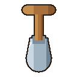

# Plan: Shovel Tool — Remove Plants + 50% Sun Refund

## Context

Bounded feature on the existing ES-module PvZ-style browser game
(`Day 9/plants_zombie`; repo root `30-Days-Vanilla-Js`; branch `main`;
baseline `802a820`, clean, tests 73 PASS in both modes).

**Spec authority:** the user's task requirements in conversation (shovel select →
tap plant → remove → refund `Math.floor(cost * 0.5)` → auto-deselect; empty tile
no-op; mutual exclusion with seed selection; edge cases; test list §35–§42;
do-not-change list §44) plus the design I presented and the user approved
(2026-10-17), including three user decisions: original generated shovel asset,
sun collection keeps priority in shovel mode, include lightweight float text.

**Test commands (both must pass after every commit):**

- `node tests/pvz-test.mjs` → baseline 73 PASS / ALL TESTS PASSED
- `SPRITE_STUB=1 node tests/pvz-test.mjs` → baseline 73 PASS / ALL TESTS PASSED

**Architecture facts (verified by reading):**

- Plants live ONLY in `state.grid[row][col]`; there is no plant entity array —
  removal is one assignment.
- `updateZombies` (zombies.js) re-reads the grid every frame and computes
  `z.eating = false` first → grid removal makes an eating zombie resume walking
  (must still be proven by test).
- Repeater pending shot lives on the plant object (`shotsLeft`, `nextShotAt`) →
  discarded with the plant. In-flight projectiles (`state.projectiles`) and sun
  pickups (`state.suns`) are independent arrays that survive removal.
- `updateUI(state)` runs once per frame in `main.update()` → HUD sun counter
  syncs automatically after a refund.
- Canvas click handler in `ui.js` begins with `if (state.gameOver) return;` →
  shovel dig is gated on Game Over for free.
- Test harness: `document.querySelectorAll` returns `slots` for `.plant-slot`;
  `clickCanvas(x,y)` fires every click listener; `Math.random → 0.5`;
  `performance.now()` returns the controllable `now`; DOM stubs lack
  `document.addEventListener` and any `.tool-slot` selector today.

**Asset tooling:** pngjs lives in `/tmp/opencode/node_modules` (previous
generators `/tmp/opencode/gen-assets.js`). Shovel generator runs there; PNG is
written/copied to `images/shovel.png`. Generator script itself is NOT committed.

## Global Constraints

1. Health stays strictly `1 = alive / 0 = immediate Game Over`. Do not touch
   health, home boundary, Game Over trigger, or restart-health behavior.
2. Do NOT change: zombie HP/speed/spawn, projectile damage/speed, attack/sun
   intervals, plant prices (50/100/50/175/200), level progression, lawn
   styling, responsive behavior, existing zombie/UI polish.
3. Refund is config-driven: `Math.floor(PLANT_TYPES[type].cost *
   BALANCE.SHOVEL_REFUND_RATE)` — never per-plant refund constants.
4. No official PvZ assets, no hotlinking, no audio.
5. Preserve the one-way module dependency structure; do NOT create tools.js
   (shovel logic lives in ui.js + plants.js + config.js).
6. Both test modes green after every commit.
7. Commits: `git -c user.name=root -c user.email=root@localhost commit -m "..."`.
8. TDD: every task writes its tests first, watches them fail for the right
   reason, then implements. (Ruling recorded in ledger: the user's assembly
   order STEP 1–10 → STEP 11 "add tests" is honored as feature order; each
   behavior's test still precedes its code.)

## Pre-flight: shared interfaces

- Task 1 → Tasks 2–5: `state.selectedTool` (`null|'shovel'`), `state.floatTexts`
  (array), `state.hoverCell` (`{row,col}|null`), `BALANCE.SHOVEL_REFUND_RATE`
  (0.5) — names fixed as stated; no later task renames them.
- Task 2 → Tasks 3–5: `.tool-slot` selector convention — stub array fires via
  `tools[0].fire('click')`; `document.querySelectorAll` extended for
  `'.tool-slot'`; `document.addEventListener` added for keydown.
- Task 3 → Tasks 4–5: `removePlantWithRefund(state, row, col) → number`
  (refund, 0 if empty) exported from `plants.js`.
- Task 2 + Task 3 → Task 5 acceptance: shovel-button gameOver guard (Task 2)
  and dig gameOver guard (Task 3) compose the §42 game-over block test.

## Task 1: Config constant, state fields, shovel asset

### Goal
`BALANCE.SHOVEL_REFUND_RATE = 0.5`; `state.selectedTool = null`,
`state.floatTexts = []`, `state.hoverCell = null`; original cartoon
`images/shovel.png` generated and visually verified.

### Steps
1. RED — add tests at the end of `tests/pvz-test.mjs` (before the final
   summary lines): import `BALANCE` from config, assert
   `BALANCE.SHOVEL_REFUND_RATE === 0.5`; assert fresh `createState()` (via the
   live `state`) has `selectedTool === null`, `Array.isArray(state.floatTexts)
   && state.floatTexts.length === 0`, `state.hoverCell === null`.
   Run both modes. Expected: FAIL (undefined) — failure names these fields.
2. GREEN — `js/config.js`: add `SHOVEL_REFUND_RATE: 0.5,` to `BALANCE`
   (comment: shovel refund = floor(cost * rate), e.g. Snow Pea 175 → 87).
   `js/state.js`: add the three fields with comments (selectedTool is the
   one-use tool selection, mutually exclusive with selectedPlant; floatTexts =
   transient refund feedback; hoverCell = presentation pointer target).
   Run both modes. Expected: PASS, count grows, 0 FAIL.
3. Generate `images/shovel.png`: original cartoon shovel (wooden handle with
   grip, steel-gray spade, bold dark outline, transparent background, square
   canvas ~128×128, style consistent with `images/wallnut.png` pipeline).
   Verify by reading the PNG image itself (visual check) and with a byte/size
   sanity check (`file`/`identify` fallback: node reading IHDR width/height).
   Expected: renders as a clean cartoon shovel, not blank.

### Commit
`Add shovel config constant, tool state fields, and original shovel asset`

## Task 2: Shovel button, selection state, mutual exclusion, restart reset

### Goal
Shovel button in the seed bank (tool styling, no cost), toggle selection wired
through the existing click system, mutual exclusion with seed selection, Escape
cancel, restart reset. Covers design steps 3–5 + parts of §16, §31, §32.

### Steps
1. RED — extend test stubs: `makeTool()` slot stub (classList/addEventListener/
   fire like `makeSlot`, `querySelector` returns null), `tools` array with one
   shovel entry, `document.querySelectorAll` returns `tools` for `'.tool-slot'`,
   `document.addEventListener` registry + a `fireDocument(ev, e)` helper.
   Add tests:
   - shovel slot exists (exactly 1 `.tool-slot`), seed bank still has exactly
     5 `.plant-slot`; shovel stub has no plant cost (stub/`dataset` has no
     cost element — assert `slot.querySelector('.plant-cost') === null` in the
     real markup sense: assert markup via label text set by wireInput: shovel
     name element gets 'Shovel' — model the stub after makeSlot with
     `dataset.tool='shovel'` so wireInput can set its label).
   - `tools[0].fire('click')` → `state.selectedTool === 'shovel'` and
     `state.selectedPlant === null` and shovel class `selected` and no seed
     has `selected`.
   - then `slots[1].fire('click')` → `selectedPlant === 'peashooter'`,
     `selectedTool === null`, shovel class cleared (selecting seed cancels
     shovel).
   - re-fire shovel → toggles off (`selectedTool === null`).
   - Escape: select shovel, `fireDocument('keydown', {key:'Escape'})` →
     `selectedTool === null`.
   - while shovel selected: `slots[0].fire('click')` → seed wins (plant
     selected, tool null) — the reverse direction of §10.
   - `restartGame()` after selecting shovel → `selectedTool === null`,
     shovel class cleared, `floatTexts` empty (§32).
   Run both modes. Expected: FAIL (no wiring, `selectedTool` stays null etc.).
2. GREEN — `index.html`: after the 5 `.plant-slot` divs inside `.seed-bank`,
   add:
   ```html
   <div class="tool-slot" id="shovel-slot" data-tool="shovel" role="button"
        aria-label="Shovel: select, then tap a plant to remove it">
     
     <span class="tool-name">Shovel</span>
   </div>
   ```
   `style.css`: `.tool-slot` — same tray footprint as `.plant-slot`
   (`width: clamp(76px, 12vw, 92px)`), but tool look: darker/steel palette
   (`#dfe4e8 → #c3ccd2` gradient, `#3c4650` border), `margin-left: auto` +
   left divider (`border-left`/padding) so it separates from plant cards,
   `cursor: pointer`, `user-select: none`, same `box-shadow` lift + hover;
   `.tool-slot.selected` = gold border + glow (mirror `.plant-slot.selected`
   with `border-color: var(--sun)` + `box-shadow 0 0 0 2px var(--sun)` glow);
   `.tool-img` sized like `.plant-img`; `.tool-name` uppercase like
   `.plant-name`; `prefers-reduced-motion` disables `.tool-slot` transition.
   No cost element → no sun cost shown.
   `js/ui.js` in `wireInput`:
   - shovel wiring: `document.querySelectorAll('.tool-slot')` — click →
     `if (state.gameOver) return;` (§31: Game Over takes priority); toggle
     `state.selectedTool` ('shovel' ↔ null); on activate clear
     `state.selectedPlant` + all `.plant-slot` `selected` classes; on
     deactivate/activate toggle its own `selected` class.
   - seed-slot click handler additionally clears `state.selectedTool` +
     `.tool-slot` selected classes (mutual exclusion both ways).
   - label sync: set `.tool-name` text from a `TOOLS = {shovel: 'Shovel'}`
     label table? Simpler: hardcode label in markup; wireInput only needs the
     click wiring. (Markup carries the label; tests assert markup label via
     the stub's preset text.)
   - Escape: `document.addEventListener('keydown', e => { if (e.key ===
     'Escape' && state.selectedTool) { state.selectedTool = null; clear
     classes; } })`.
   `js/main.js` `restartGame()`: `state.selectedTool = null;
   state.floatTexts = [];` and remove `selected` from `.tool-slot` elements
   next to the existing `.plant-slot` cleanup.
   Credits (`index.html` footer, appended line, existing credits kept):
   `Shovel artwork: original project asset created for this game.`
   Run both modes. Expected: PASS, 0 FAIL; count grows accordingly.
3. Sanity: `grep` that `updateUI`'s `.plant-slot` loop does not touch
   `.tool-slot` (it must not — no cost/unaffordable logic on the tool).

### Commit
`Add shovel tool button with mutually exclusive selection and restart reset`

## Task 3: Generic removal, 50% refund, click flow, edge cases

### Goal
`removePlantWithRefund` in plants.js; dig branch in canvas click; all §35–§42
behavior tests. Covers design steps 6–9.

### Steps
1. RED — write ALL of the following tests first (they fail because the dig
   branch / removePlantWithRefund do not exist yet; the first control test
   fails on `state.sun` unchanged):
   - **§35 refunds, all five types** (real UI path): reset board
     (`grid.fill(null)`, `zombies=[]`, `projectiles=[]`, `suns=[]`,
     `waveInterval=1e9`, `sun=1000`, `selectedPlant=null`), plant each type
     via select+click, then `tools[0].fire('click')` + `clickCanvas(cell)`
     and assert exact sun deltas: sunflower +25, peashooter +50, wallnut +25,
     snowpea +87 (`Math.floor(175*0.5)`), repeater +100; grid cell `null`
     after each; `selectedTool` back to `null` after each dig (one-use).
   - **§36 empty tile**: select shovel, click empty tile → sun unchanged,
     `selectedTool` still `'shovel'`, no error.
   - **§14 outside lawn**: shovel active, `clickCanvas(-40, -30)` (and a
     point past the right/bottom edge) → nothing changes, shovel stays
     selected.
   - **§38 damaged wall-nut**: set `wall.hp = 41`, dig → +25 (HP-independent).
   - **§39 zombie eating (wall-nut)**: zombie in eating range of wall-nut,
     `step` until `eating === true`, dig the wall-nut → cell null, refund +25,
     `step(3)` → `eating === false` and zombie x decreased (resumes walking),
     no crash; **second type**: peashooter being eaten the same way (set up
     zombie adjacent in lane, step until eating) → dig → resumes.
   - **§40 repeater pending shot**: repeater in lane with a static zombie;
     run until the first pea is in flight (`state.projectiles.length >= 1`)
     but before the 2nd shot (measure within `shotDelay`=200ms window), dig
     → refund +100, in-flight pea still in `state.projectiles` and continues
     moving; run past +200ms → no NEW projectile appears beyond the
     already-in-flight one (pending shot canceled).
   - **§41 sunflower**: sunflower produced a sun (`state.suns.length >= 1`),
     dig → sun pickup STILL in `state.suns`, refund +25; run past its
     `sunInterval` → `state.suns.length` does not grow from that plant
     (existing pickups only age out if expired — use a short window before
     TTL 8000 or count sunflowers-generated entries by position).
   - **§42 game-over block + restart**: control dig on a live plant works
     (same run proves the dig exists — this is the RED anchor), then
     `state.gameOver = true` mid-session with shovel selected: attempt dig on
     a planted tile → plant remains, sun unchanged, `selectedTool` unchanged
     (`'shovel'`); then `restartGame()` → `health === 1`,
     `selectedTool === null`, shovel class cleared.
   Run both modes. Expected: FAILs naming sun/refusal outcomes (right reason).
2. GREEN —
   `js/plants.js`: export
   ```js
   export function removePlantWithRefund(state, row, col) {
     const plant = state.grid[row][col];
     if (!plant) return 0;
     const refund = Math.floor(PLANT_TYPES[plant.type].cost * BALANCE.SHOVEL_REFUND_RATE);
     state.grid[row][col] = null;
     state.sun += refund;
     return refund;
   }
   ```
   (import `BALANCE` alongside `PLANT_TYPES`).
   `js/ui.js` canvas click: after the sun-collection loop, before
   `if (state.selectedPlant)`:
   ```js
   if (state.selectedTool === 'shovel') {
     const col = Math.floor(mx / CELL_W), row = Math.floor(my / CELL_H);
     if (col >= 0 && col < COLS && row >= 0 && row < ROWS) {
       const refund = removePlantWithRefund(state, row, col);
       if (refund > 0) {
         state.selectedTool = null;
         document.querySelectorAll('.tool-slot').forEach(t => t.classList.remove('selected'));
         updateUI(state);
       }
     }
     return; // shovel mode: never falls through to planting
   }
   ```
   (import `removePlantWithRefund` from plants.js; empty/out-of-bounds →
   shovel stays selected; sun collection already happened above per approved
   design).
   Run both modes. Expected: all new tests PASS, full suite 0 FAIL.
3. Confirm with grep: no per-plant refund numbers anywhere; refund rate only
   in `config.js`.

### Commit
`Add generic plant removal with config-driven 50% shovel refund`

## Task 4: Visual feedback — float text, hover highlight, cursor

### Goal
Lightweight `+N SUN` float text (push + fade + cleanup), `hoverCell` tracking,
amber outline on shovel-target tile, crosshair cursor. Covers design step 10 +
§18, §19, §25.

### Steps
1. RED — tests first:
   - after a dig: `state.floatTexts.length === 1`, text `'+25 SUN'`,
     `x/y` at the dug tile center (`cellX/cellY`), `at === nowValue()`;
     snowpea dig → `'+87 SUN'`.
   - cleanup: push a fake old entry (`at: nowValue() - 1300`), call `draw()`
     → old entry removed, fresh entry retained (`FLOAT_TEXT_MS = 1200`).
   - mousemove sets `state.hoverCell`: fire `canvas.listeners.mousemove` at a
     cell center → `{row, col}` matches; fire outside bounds (e.g. clientX
     -50) → `hoverCell === null`.
   - cursor: shovel selected + mousemove over lawn →
     `canvas.style.cursor === 'crosshair'`; shovel NOT selected → `''`;
     shovel selected but hovering a collectible sun → `'pointer'` (sun keeps
     priority).
   - smoke: select shovel, set hoverCell to a planted tile, `draw()` runs
     without throwing (both modes).
   Run both modes. Expected: FAIL (floatTexts never pushed, hoverCell never
   set, cursor '' when shovel active).
2. GREEN —
   `js/ui.js`: on successful dig push
   `{ x: cellX-c, y: cellY-r, text: '+' + refund + ' SUN', at: performance.now() }`
   (use the same tile-center math as planting: `col*CELL_W+CELL_W/2`).
   In the existing mousemove handler: compute row/col bounds →
   `state.hoverCell = inBounds ? {row, col} : null`; cursor logic order: sun
   over → `'pointer'`, else `state.selectedTool === 'shovel'` →
   `'crosshair'`, else `''`.
   `js/rendering.js`: add `drawShovelTarget(state)` — when
   `state.selectedTool === 'shovel' && state.hoverCell` and that cell has a
   plant: amber outline (`strokeStyle '#ffb300'`, lineWidth 3, inset rect)
   + subtle translucent fill (`rgba(255,179,0,0.14)`); call it in `draw()`
   after the planting preview. Add `drawFloatTexts(state)` — alpha fades from
   1→0 over `FLOAT_TEXT_MS = 1200` (module const), rises up to −26px,
   `fillStyle '#ffd740'`/outline, `bold 15px`, `textAlign 'center'`; stale
   entries are filtered out here (rendering owns the effect lifetime), fresh
   entries drawn; call in `draw()` before the game-over overlay.
   Run both modes. Expected: PASS, 0 FAIL.
3. Visual check of behavior is deferred to Step 13/manual (browser tool
   unavailable); logic is test-covered.

### Commit
`Add shovel refund float text, target highlight, and crosshair cursor`

## Task 5: Acceptance sweep, full suite, smoke verification

### Goal
Everything green and verified end-to-end (user's steps 11–13). No feature code
changes expected.

### Steps
1. Re-read the visual acceptance checklist (user §43) and assert the
   machine-checkable items via one final acceptance block in the test file if
   any are not yet covered (candidates: seed selection cancels shovel through
   the REAL click path order — shovel → seed → dig refused because shovel is
   null and seed placement only happens when selectedPlant set; assert that
   clicking a planted tile with only a seed selected does NOT remove the
   plant).
2. Run `node tests/pvz-test.mjs` → ALL TESTS PASSED, 0 FAIL. Record final
   assertion count.
3. Run `SPRITE_STUB=1 node tests/pvz-test.mjs` → ALL TESTS PASSED.
4. HTTP smoke: `python3 -m http.server 8765` in the project dir (background),
   curl `-o /dev/null -w '%{http_code}'` for `/`, `style.css`, every `js/*.js`,
   every `images/*.png` incl. `images/shovel.png` → all 200; kill server.
5. Re-verify asset visually (read `images/shovel.png`) and confirm
   `git status` shows only intended files; `grep -ri "pvz\|plants vs" images/`
   sanity: no ripped asset added (only original shovel).
6. Update `task.md`? — no: this feature has its own record; do NOT edit the
   previous feature's task.md. Report lives in the final message.

### Commit
`Add shovel acceptance tests and verification results` (only if test additions
happen in step 1; otherwise no commit — the sweep is evidence, not code)

## Review Focus (for final reviewer)

Input classes and failure modes the tests do NOT exercise:

- Real-browser/touch behavior: synthesized click coordinates vs.
  `getBoundingClientRect`, touch tap target size, seed-bank horizontal scroll
  with 6 items on narrow screens.
- CSS layout of `.tool-slot` (divider, `margin-left: auto` inside an
  `overflow-x: auto` flex tray) on landscape tablet and ≤520px widths.
- Actual visual quality of `images/shovel.png` and its harmony with the UI.
- `mousemove` handler cost per frame and cursor flicker at lawn edges.
- Float-text behavior across game over (update() early-returns; draw() still
  fades them — cosmetic only).
- Double-timing: digging the same tile twice fast (second dig sees null → 0 →
  shovel stays selected — by design).
- Escape key interacting with browser/tab focus on tablets (harmless no-op).
